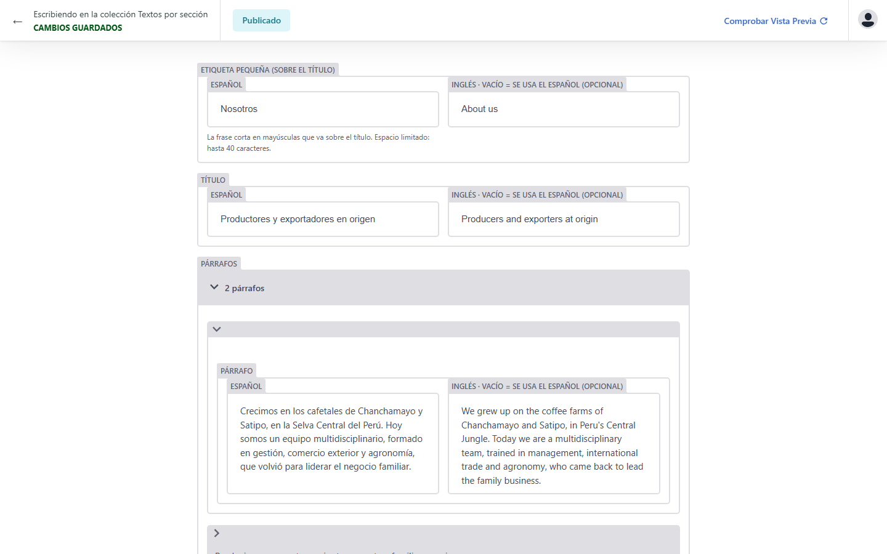

# Cómo cambiar las fotos y los textos de la web

Para quien administra el sitio. No hace falta saber de programación. Desde el mismo panel cambias **las fotos** y **todos los textos** (en español y en inglés). No se pueden crear ni borrar secciones ni páginas: la estructura de la web la mantiene el técnico.

## Cambiar una foto (paso a paso)

1. Entra a **https://TUDOMINIO.com/admin/** (cámbialo por la dirección real de tu web, terminada en `/admin/`).
2. Pulsa **Iniciar sesión con GitHub** y entra con tu cuenta de GitHub. La primera vez te pedirá permiso: pulsa **Authorize** (autorizar).
3. Haz clic en **Fotos del sitio** (si aparece una lista con ese mismo nombre, haz clic otra vez). Verás una lista con cada espacio de foto de la web: «Foto principal (portada)», «Nosotros: equipo», «Proyecto 1», «Cacao en grano», «Galería 1: cosecha»…
4. Abre el espacio que quieres cambiar (clic en su nombre).
5. En **Foto** pulsa **Elige una imagen diferente** → **Subir nuevo** → elige el archivo de tu computador → **Confirmar selección**.
6. Escribe el **texto alternativo** en español (una frase que diga qué se ve en la foto, por ejemplo «Mujer cosechando cerezas de café») y, si puedes, también en inglés. Es lo que leen los lectores de pantalla y Google.
7. *Opcional:* si la foto tiene otra forma y la web corta algo importante, usa el **punto focal** (0 a 100): horizontal 0 = izquierda, 100 = derecha; vertical 0 = arriba, 100 = abajo. Si lo dejas vacío, el recorte se centra.
8. Arriba pulsa **Publicar** y luego **Publicar ahora**.

## Cambiar un texto (paso a paso)

1. Entra al panel **https://TUDOMINIO.com/admin/** e inicia sesión con GitHub, igual que para las fotos (pasos 1 y 2 de arriba).
2. En la lista de la izquierda elige dónde está el texto:
   - **Textos por sección**: lo que dice cada parte de la web (Inicio, Nosotros, Calidad, menú superior, pie de página…).
   - **Productos**: nombres, descripciones y datos de los cafés y cacaos.
   - **Contacto y ajustes**: correos, WhatsApp, direcciones, redes sociales, título que ve Google, datos legales y los avisos del formulario.
3. Haz clic en la sección que quieres (por ejemplo **Inicio (portada)**). Verás los textos de esa parte, **en español a la izquierda y en inglés a la derecha**.

   
4. Escribe el cambio dentro del cuadro. Algunos textos son listas (tarjetas, pasos, preguntas): haz clic en el ítem para abrirlo y editarlo.
5. Arriba pulsa **Publicar** y luego **Publicar ahora**. Si algún cuadro se pone en rojo, lee el mensaje (casi siempre es que el texto es demasiado largo para el espacio) y corrígelo; no se publica hasta que todo esté bien.
6. En **1 o 2 minutos** el cambio está en la web (ver «Cuánto tarda»).

Consejos:

- **Inglés vacío:** si dejas el cuadro en inglés vacío, la web muestra el texto en español en los dos idiomas. El español nunca puede quedar vacío (la web conserva el texto anterior).
- **Negrita, cursiva y salto de línea:** en los cuadros grandes, **Enter** baja de línea; escribe `**así**` para negrita y `*así*` para cursiva (con los asteriscos pegados al texto). No uses nada más: enlaces, colores o código no se aceptan y se borran solos.
- **Largo del texto:** en los espacios chicos (botones, títulos de tarjetas) el panel indica «hasta N caracteres» para que el diseño no se desordene.
- **Datos pendientes:** lo que dice `[pendiente]` o `[000]` (entre corchetes) todavía **no se muestra** en la web. Cuando escribas el dato real sin corchetes (por ejemplo `120` familias o `1,200 msnm`) se publica solo. El enlace de TikTok funciona igual: mientras esté vacío, el ícono no aparece.
- **Correo, WhatsApp, RUC:** el panel revisa que tengan forma correcta (por ejemplo, el WhatsApp son solo números con código de país). El enlace de la red WhatsApp y el botón «Síguenos en LinkedIn» se actualizan solos con esos datos.
- **Formulario:** en «Contacto y ajustes → Formulario: avisos y opciones» hay textos con `{n}`, `{total}` o `{email}`: no los borres, la web pone ahí la cantidad, el total o el correo.

Lo que **no** se cambia desde el panel (pídelo al técnico): crear, borrar o mover secciones y páginas; agregar o quitar ítems de una lista (tarjetas, pasos, certificaciones…); el destino de los enlaces del menú y de los botones; colores, íconos y logos; la lista de países y las cantidades en gramos del formulario; las publicaciones de LinkedIn.

## Cuánto tarda

La web se actualiza sola en **1 o 2 minutos**. Si no ves el cambio, recarga con **Ctrl + F5** (en celular, cierra y abre el navegador). Pocas veces puede tardar unos minutos más.

## Qué tamaño usar

- Sube la foto **tal como sale de la cámara o del celular**. Mejor si mide **1200 píxeles de ancho o más** (si es más chica, se ve borrosa).
- Formatos: **JPG, PNG o WebP**. Las fotos de iPhone en formato HEIC se guardan primero como JPG.
- Peso: hasta **10 MB** por foto.
- No importa si es vertical u horizontal: la web la recorta sola. Lo ideal por espacio:

| Espacio | Forma ideal |
|---|---|
| Foto principal (portada) | vertical (4 de ancho por 5 de alto) |
| Nosotros y Galería | horizontal clásica (4 por 3) |
| Proyectos | horizontal (16 por 10) |
| Cacao en grano y Derivados | panorámica (16 por 9) |

- **Galería 6** puede ser un **video**: archivo **.mp4**, **de hasta 20 MB** (si pesa más, comprímelo antes). Además sube una foto como portada del video.

## Qué NO hacer

- No subas fotos de **menores de edad** ni de personas sin su **autorización de imagen**.
- No subas fotos de más de 10 MB ni videos de más de 20 MB.
- No entres a GitHub a borrar o renombrar archivos: usa solo este panel.
- No copies textos con formato desde Word o desde una página web sin revisar cómo quedan: pega como **texto sin formato**.
- No cierres la pestaña antes de pulsar **Publicar** y **Publicar ahora**: el cambio no se guarda.
- No cambies fotos por otras que no sean de YOUTH COOP o que no tengas derecho a usar.
- No compartas tu cuenta de GitHub con otras personas: si alguien más va a editar, avisa para invitarlo con su propia cuenta.

## Ver el historial y deshacer un cambio

- **Volver al texto anterior:** vuelve a escribir el texto que había (si no lo recuerdas, mira el historial como se explica abajo: cada cambio muestra en rojo lo que había y en verde lo nuevo) y publica de nuevo.
- **Volver a la foto anterior:** en el espacio, pulsa **Elige una imagen diferente**: ahí aparecen **todas las fotos que subiste antes**. Elige la anterior y publica.
- **Ver quién cambió qué y cuándo:** en `https://github.com/OWNER/REPO/commits/main` (cámbialo por el repositorio real) aparece cada cambio con fecha, hora y su autor.
- Si algo salió mal y no logras arreglarlo, escribe al técnico: cada versión anterior de la web queda guardada y se puede recuperar.
